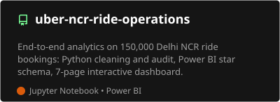

<h1 align="center">Harshvardhan Singh</h1>
<h3 align="center">Data Analyst | Business Analyst | Mumbai, India</h3>

  <i>Finding the story in the data.</i>

  

Hi 👋 I'm Harshvardhan, a B.Tech Electronics & Computer Engineering student who turns raw data into decisions. I work with Python, SQL and Power BI on forecasting, customer analytics and data warehousing, and I'm especially interested in finance analytics and data infrastructure.

  

---

## 🚀 Top Repositories

<table>
  <tr>
    <td width="50%" align="center">
      
    </td>
    <td width="50%" align="center">
      
    </td>
  </tr>
  <tr>
    <td width="50%" align="center">
      
    </td>
    <td width="50%" align="center">
      
    </td>
  </tr>
</table>

| Project | What it covers |
|---|---|
| **Uber NCR Ride Operations** | Demand, cancellations, vehicle and revenue analysis of 150,000 NCR ride bookings, ending in a 7-page black-glass Power BI dashboard |
| **Financial Operations Analytics** | Revenue forecasting, churn prediction and customer clustering on 5 years of simulated SaaS data, with a focus on finding and fixing data leakage |
| **Retail & Marketing Analytics** | RFM segmentation, customer lifetime value and cohort retention across 10,000 retail orders |
| **E-Commerce Analytics Warehouse** | Real Olist Brazilian e-commerce data cleaned in Python, modelled as a star schema with SQL, and presented in a 6-page deep-green Power BI dashboard |

---

## 🛠️ Skills

### Languages & Databases

### Libraries

### Visualization & BI

### Tools

### Concepts

---

## 🎓 Certifications

| Certification | Issued by | Completed | ID |
|---|---|---|---|
| Registered Scrum Basics™ | Agile Education, powered by Scrum Inc. | Oct 8, 2026 | RSB-5234667 |
| AWS Cloud Practitioner Essentials | AWS Training & Certification | Oct 12, 2026 | n/a |
| Data Analytics Essentials | Cisco Networking Academy | Sep 30, 2026 | [Credly badge](https://www.credly.com/badges/e589dac0-fa40-412a-9a28-162aab082f02/public_url) |

---

## 📈 Impact in Numbers

### 1️⃣ Uber NCR Ride Operations
*Where do ride bookings succeed, and where are they lost? 150,000 Delhi NCR bookings, from raw CSV to a 7-page dashboard*

  
  
  
  
  

| | |
|---|---|
| **Scope** | 150,000 ride bookings from Delhi NCR (Jan to Dec 2024), a public Kaggle dataset that appears synthetic, so findings describe this dataset and not Uber's real business |
| **Key findings** | • Only **62.0%** of bookings became completed rides: 57,000 of 150,000 were lost • **Drivers cause 72%** of cancellations (18.0% of all bookings vs 7.0% for customers) • About **₹24.4M** of revenue is at risk (estimate: 48,000 cancelled or no-driver bookings × ₹508 average fare) • Demand peaks at **18:00**, 9.4x the quietest hour • **UPI is 45.0%** of revenue; digital payments make up 75.1% |
| **Rigor** | Found 1,233 booking IDs repeated across 2,457 rows, confirmed they were different rides and kept them all with a unique key. Audited ratings, fares, distances and outcome flags, and found fares do not follow distance (correlation 0.006) |
| **My contribution** | Cleaned and audited the data in Python, built a star schema with DAX measures in Power BI, and designed the full dashboard, theme, vehicle illustrations and icons myself |

  
  

---

### 2️⃣ Financial Operations Analytics
*End-to-end analytics on a simulated 5-year SaaS business: forecasting, churn, segmentation and retention*

  
  
  
  
  

| | |
|---|---|
| **Scope** | 5,000 customers and 135,218 transactions (2020 to 2024), synthetic data with a planted usage-score → churn signal so every model could be checked against ground truth |
| **Key findings** | • **$3.5M/year** of revenue flagged at risk across **1,166 active customers** above a 15% churn-probability threshold • The **"At Risk" RFM segment holds $10.4M**, more than "Champions" at $8.1M, so the most valuable customers are showing early warning signs • K-Means found behavioral segments that cut across pricing tiers instead of just mirroring plan price |
| **Rigor** | Caught a **data leakage bug**: the first churn models scored a suspicious 1.000 ROC AUC because `recency_days`, `lifetime_months` and `transaction_count` encoded the outcome. Rebuilt with genuine leading indicators for an honest **0.756 ROC AUC** (Gradient Boosting). Cohort rankings exclude cohorts under 6 months old to avoid survivor bias |
| **Forecasting** | ARIMA and Prophet models reached **0.77% MAPE** on held-out data |
| **My contribution** | Built the full pipeline in Python (forecasting, churn modelling, RFM, K-Means, cohort retention) and presented it in an interactive 5-page Power BI dashboard |

---

### 3️⃣ Retail & Marketing Analytics
*What a retail business's sales data says about its customers*

  
  
  
  
  
  

| | |
|---|---|
| **Scope** | 10,000 orders from 1,986 customers, Jan 2022 to Feb 2023 (synthetic dataset) |
| **Business snapshot** | $1,078,670.98 revenue at an 18.4% profit margin, with an average order value of $107.87 and 10.9% of customers inactive for 180+ days |
| **Key findings** | • Identified **14% of customers (278 users)** in the "At Risk" segment representing **~$194K** in past revenue with average individual spends of $698 • Electronics ($328K) and Office Supplies ($321K) drive **~60% of total revenue** • Discounting showed zero correlation with sales or profit (0.00 to 0.02), highlighting ineffective promotion spend |
| **My contribution** | Cleaned and explored the data, grouped customers by behaviour (RFM segmentation, lifetime value, cohort retention) across 4 notebooks, and built a 5-page Power BI dashboard: Executive Overview, Customer Segmentation, Sales Deep Dive, Cohort & Retention, Customer Value |

---

### 4️⃣ E-Commerce Analytics Warehouse
*Real Olist Brazilian e-commerce data, from raw CSVs to a star schema and a 6-page dashboard*

  
  
  

| | |
|---|---|
| **Outcome** | Rebuilt an earlier sample-data warehouse on the real Olist dataset, with a data audit and cleaning notebook, SQL scripts, and a 6-page Power BI dashboard: Executive Overview, Sales & Revenue Trends, Products & Categories, Customers & Retention, Orders & Fulfilment, Insights & Recommendations |
| **My contribution** | Audited and cleaned the data in Python, designed the star schema and SQL, and built the dashboard layout, deep-green theme and icon set myself |

---

### 5️⃣ PostgreSQL ACID Transaction Ledger
*Safe money transfers under concurrent load*

  

| | |
|---|---|
| **How it works** | • Atomic debits, credits and transaction logging inside a single `conn.begin()` block with automatic rollback on failure • Non-negative balances enforced at database level with a `CHECK (balance >= 0)` constraint |
| **Outcome** | A ledger designed to prevent race conditions, balance inconsistencies and negative balances during multi-threaded concurrent transfers, tested under `READ COMMITTED` and `SERIALIZABLE` isolation levels |
| **My contribution** | Wrote the schema (`schema.sql`), the transfer logic (`transfer.py`) and a concurrency test (`concurrency_test.py`) |

---

## 🌐 Portfolio Website

## 📫 Contact

